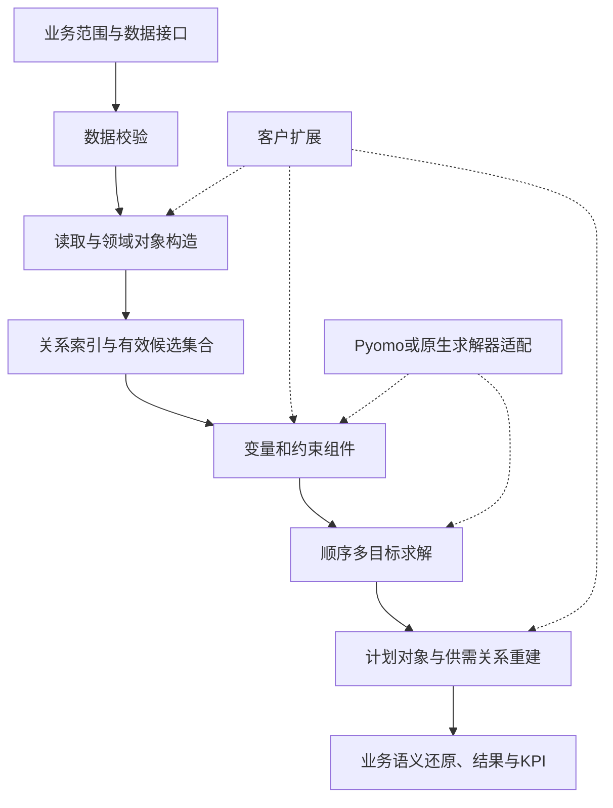

# MPS／SOP／MRP 一体化框架：产品设计与技术详解

更新日期：2026-11-02。用于 Meta IC5、偏产品经理职责的面试。依据本人补充、简历，以及 `D:/yhl_back/scp` 和 `D:/yhl_back/pan_aps` 的静态源码阅读。

## 1. 核心定位：帮助新人快速完成计划模型交付

**[本人确认]** 框架的直接目标，是让新手算法工程师能快速上手解决 MPS、SOP、MRP、日计划等问题。面试应先讲使用者和交付过程，再讲代码复用。

**主线：把一次计划模型交付所需的数据理解、对象组织、建模、求解和结果解释形成共用流程，让新人沿着明确的扩展位置完成新场景，而不必从零搭建全部基础设施。**

**[本人补充] 平台价值还包括团队协作：** 统一模型骨架、领域模型及术语定义，使项目交接、多人合作、新开发者加入和代码审查都有共同的理解基础。结合共用组件减少重复开发，整体价值是**提升开发效率、降低开发成本**。当前没有提供效率或成本改善的统一量化比例。

**可复用性的建模基础：MPS、MRP、SOP 这类问题都很适合使用 Discrete-time Production Planning Models（离散时间生产计划模型）建模。** 它们共同涉及各时段的需求、物料投入产出、供应、库存和生产安排，因此可以共享时间结构、领域对象、流量平衡及主要建模组件，再通过产能策略、约束与目标表达不同计划需求。

### 本人贡献与协作分工

| 内容 | 已确认的责任 | 面试表述 |
|---|---|---|
| 框架整体 | 简历为算法负责人，设计端到端算法工作流并指导工程师 | I led the algorithm framework design and guided engineers using it. |
| 领域对象 | 并非全部由本人独立设计；基本参考本人在奥克斯项目中设计的领域对象 | The domain model was not entirely my individual design; it largely drew on my earlier work at AUX. |
| 求解器适配 | 完全由本人设计与开发 | I designed and implemented the solver adaptation layer. |
| 产品接口 | 产品经理根据领域对象设计 | The product manager designed the product interfaces based on the domain objects. |
| 客户扩展 | 代码可见继承与局部覆盖；本人有松下算法方案设计经历 | 用松下说明共用能力如何扩展，不将所有模块和客户交付都归为个人独立完成 |

产品接口、内部建模方法和求解器 API 是三个不同层次。产品接口由 PM 设计，不意味着内部每个建模方法也都由 PM 实现；本人负责适配层，也不意味着全部领域对象和产品接口由本人独立设计。

### 本文的证据口径

- **[本人确认]** 对话中补充的历史事实和分工。
- **[代码可见]** 当前备份直接体现的结构、调用与处理。
- **[设计解释]** 从实现分析其作用与代价，不冒充当时逐项记录的决策过程。
- **[建议方法]** 面向未来的验收或改进，英文使用 would。

### “一体化”具体体现在哪里

当前代码能支持的表述是：**共享领域对象、输入组织、供需与资源模型、求解流程和结果结构，再用子类与配置表达计划场景差异。**

MRP、MPS、SOP 各有入口与上下文，不是同一个参数不变的模型。代码也不证明已经具备统一交互界面、完整 S&OP 会议审批机制，或 SOP → MPS → MRP 自动串联的业务闭环。SOP 在本文对应仓库的 `sop` 计划算法模块；完整 S&OP 管理流程超出当前源码证明范围。

## 2. 从一次新人交付看端到端流程



| 步骤 | 工程师需要明确什么 | 共用能力与输出 | 主要证据 |
|---|---|---|---|
| 1. 定义问题 | 用户要决定产量、采购、运输、库存还是交付；范围与粒度是什么 | 选择计划模块，明确输入和目标，不默认所有问题都要详细排程 | 三类 `launch_*.py` 与 Context |
| 2. 校验输入 | 表是否齐备、主键与引用是否一致、时间是否连续 | `DataChecker` 检查唯一性、引用、必填、库存点物料、替代与采购比例等，并输出错误 | [数据校验](D:/yhl_back/scp/scp/checker/data_checker.py:20) |
| 3. 构造对象 | 外部 ID 对应哪个业务对象，数量在哪个位置和时间可用 | `InputData` 读取订单、物料、位置、工艺、资源、供需等，维护 ID 与业务 code 映射 | [读取流程](D:/yhl_back/scp/scp/kernel/info/input_data.py:65) |
| 4. 编译关系 | 哪些工序生产／消耗哪些物料，哪些组合在何时有效 | 建立关联索引、有效时间和可用资源组合，形成建模集合 | [集合构造](D:/yhl_back/scp/scp/kernel/model/discrete_model_manager.py:48) |
| 5. 建立模型 | 用什么变量表达决策，需要哪些共用及客户约束 | 产量、库存、交付、欠交、采购、运输变量，流平衡及能力等约束 | [变量](D:/yhl_back/scp/scp/kernel/model/discrete_model_manager.py:1236)、[约束](D:/yhl_back/scp/scp/kernel/model/discrete_model_manager.py:1340) |
| 6. 求解 | 目标先后次序、时限与误差是什么，如何保护前序结果 | 读取目标次序和参数，顺序求解，统一解字典 | [主工作流](D:/yhl_back/scp/scp/kernel/model/discrete_model_manager.py:3021) |
| 7. 解释结果 | 数学量如何变成计划，哪笔供应满足哪笔需求 | 生成生产／采购／运输计划、Supply、Demand 与 Fulfillment | [后处理](D:/yhl_back/scp/scp/kernel/post_processor/result_storage.py:39) |
| 8. 验证交付 | 是否齐套、是否超能力、是否存在多余计划，指标口径是什么 | 合理性及一致性检查，计划与 KPI 文件 | [测试入口](D:/yhl_back/scp/ci_test/test_launch.py:26)、[KPI](D:/yhl_back/scp/scp/kernel/post_processor/result_storage.py:2350) |

这是从源码整理的交付路径，不表示每位新人当时都完成了相同培训清单。生产求解入口会生成文件，本次只静态阅读，未运行客户算例。

## 3. MRP、MPS、SOP 怎样共用，又怎样区别

### 共同的模型结构为何支持复用

MPS、MRP、SOP 都很适合使用 **Discrete-time Production Planning Models（离散时间生产计划模型）** 表达：将计划范围划分为时段，在各时段决定生产、采购、运输、库存和需求满足等数量，并通过物料平衡及时间衔接连接决策。具体场景可以只使用其中一部分决策。

因此，可复用性首先来自问题结构：同一套时间索引、物料位置对象、投入产出关系和供需平衡，可以服务不同计划层次。工程师学习一套建模基础后，便能在改变能力处理、业务约束、目标或粒度的情况下扩展到其他计划问题。这是框架能帮助新人快速上手的关键原因。

“离散时间”描述时间表示方式，产量等变量仍可连续；按业务需要加入批量、启用等整数决策。学术称谓可参考 [离散时间生产计划优化模型综述](https://doi.org/10.1080/00207543.2014.899721)。三类问题适合共用模型范式，不意味着所有场景使用完全相同的约束或求解方法。

### 在共同结构上体现差异

| 模块 | 当前备份中的具体差异 | 业务解释与边界 |
|---|---|---|
| MRP | 使用 `MRPInputData`，将标准生产资源设为无限产能；Context 将 `replenish_unsatisfied` 设为 False；沿用通用模型与后处理 | 重点分析物料与需求满足，不用有限生产能力混淆物料判断；不代表采购供应和运输等所有限制都被取消 |
| MPS | 沿用通用输入，再将资源日历映射到 shift；模型在通用约束外增加有限资源能力约束 | 在物料与需求平衡基础上考虑可用生产能力；并非自动具备所有机台级换型／排序细节 |
| SOP | 使用专门输入、模型和结果类；标准入口设置 period 与 shift 对齐；扩展正常／加班能力、加班生产与流平衡 | 提供供需与能力取舍的算法基础；具体粒度由输入配置决定，不强称固定月度或完整经营协同流程 |
| 客户日计划 | 如松下，在共用模型上增加模具、材质日历、订单状态和详细能力等 | 复用基础模型，同时承认具体执行约束需要扩展 |

**关键设计：同一套业务对象可以承载不同精度的决策，差异应体现在数据粒度、能力策略、约束、目标及输出，而不是复制三套完全无关的基础设施。**

证据：[MRP Context](D:/yhl_back/scp/scp/mrp/context/mrp_context.py:11)、[MRP 无限生产能力](D:/yhl_back/scp/scp/mrp/info/input_data.py:65)、[MPS 能力扩展](D:/yhl_back/scp/scp/mps/model/discrete_model_manager.py:13)、[MPS 日历](D:/yhl_back/scp/scp/mps/info/input_data.py:23)、[SOP Context](D:/yhl_back/scp/scp/sop/context/context.py:14)、[SOP 约束扩展](D:/yhl_back/scp/scp/sop/model/discrete_model_manager.py:183)。

## 4. 领域对象抽象：对象代表什么决定

### 4.1 为什么不只用 Product 和 BOM

同一物料在不同库存点，不能直接认为可互换使用；工艺可用性、运输和供应到达时间都会影响需求满足。因此需要同时表达**物料身份、位置、转换过程、资源和时间**。

| 对象 | 关键含义与关联 | 支持的决策 |
|---|---|---|
| `Product` | 物料身份，可关联多个 ProductStockPoint | 识别同一物料，承载物料属性 |
| `StockPoint` | 物料所处的库存位置／逻辑位置 | 区分供需位置和库存边界 |
| `ProductStockPoint`（PSP） | 物料 × 库存点；关联生产／消耗工序、采购和运输路径、库存上下限 | 对什么位置的什么物料做流量平衡 |
| `WorkOrderRouting`／`WorkOrderRoutingStep` | 路径及工序；工序关联投入、产出、能力资源、提前期、良率等 | 用哪条路径，何时生产，消耗什么、产出什么 |
| `StepInput`／`StepOutput` | 工序与 PSP 的投入产出关系，含系数与相关良率；产出有主产物标识 | 表达 BOM、多投入及多产出关系 |
| `StandardResource`／`StepResource` | 资源日历及能力策略；工序与资源间速率、优先级等 | 哪些资源能做、产量如何换算能力消耗 |
| `PurchaseOrderRouting`／Supplier | 供应商到 PSP 的采购选择及数量、成本、有效期、提前期 | 向谁采购、何时到达、数量是否受限 |
| `TransportOrderRouting`／TransportSection | 两个 PSP 间的运输及路段限制 | 从哪里转到哪里、何时到、占用多少能力 |
| `Period`／`Shift` | 计划展示周期与求解时间分段 | 用什么时间粒度表达生产、供应和需求 |
| `Demand`／`Supply` | 某 PSP 在某时点的需求／供应，关联原订单和类型 | 统一表示客户、生产等需求，以及库存、采购、生产等供应 |
| `Fulfillment` | 供应—需求—数量的对应边，含固定标识 | 追溯谁满足谁，以及哪些关系应保留 |
| `ProductionPlanned` 等 | 求解后形成的计划对象，带投入、产出及资源记录 | 将优化建议交付为业务计划 |

**一个对象不一定对应一个自由变量。** Product 与资源可以是给定数据；产量、采购量和交付量才是模型决策。Fulfillment 既可以读取既有关系，也可以在后处理中重新构建。

证据：[PSP](D:/yhl_back/scp/scp/kernel/domain_object/product_stock_point.py:5)、[工序](D:/yhl_back/scp/scp/kernel/domain_object/work_order_routing_step.py:10)、[工序资源](D:/yhl_back/scp/scp/kernel/domain_object/step_resource.py:1)、[需求](D:/yhl_back/scp/scp/kernel/domain_object/demand.py:6)、[供应](D:/yhl_back/scp/scp/kernel/domain_object/supply.py:6)、[满足关系](D:/yhl_back/scp/scp/kernel/domain_object/fulfillment.py:1)。

### 4.2 两张网络的区别

1. **可选生产与供应网络：** 哪些 PSP 可以通过生产、采购和运输相连接，资源能否承接。它描述可选方案。
2. **计划后的供需满足网络：** 哪笔具体供应满足哪笔具体需求、数量多少。它描述本次结果及追溯。

不能把“存在工艺路径”说成“已经有相应供给”，也不能把后处理中的 FIFO 追溯，说成所有主模型都按 FIFO 决策。通用框架可配置使用供应关系模型或 FIFO 重建满足关系，见 [关系选择](D:/yhl_back/scp/scp/kernel/post_processor/result_storage.py:942)。这也不改变 ATL 旧版按 MU 份额交接需求的独立结论。

## 5. 领域对象的灵活使用：通过网络结构表达业务规则

### 5.1 通用替代组：把替代选择转成虚拟工序

**业务问题：** 同一个投入需求可由不同物料或物料组合满足，且有系数、优先级和有效期等差异。

**[代码可见] 处理过程：**

1. 读取全局或工序级替代组及 match。
2. 创建虚拟 Product、StockPoint、PSP，以及虚拟组织／无限能力资源。
3. 每个 match 对应一条虚拟路径：消耗实际物料组合，产出同一虚拟 PSP。
4. 将原工序的主料投入换成虚拟 PSP，使真实生产流程通过它取得可选投入。
5. 共用流平衡与优先级机制选择方案；虚拟替代 PSP 的库存被约束为零。
6. 后处理删除虚拟替代步骤在满足网络中的中间关系，连接回真实业务对象。

**讲解示意，非客户数据：** 一单位投入可以用 A，或用两单位 B。构造 `A → V` 与 `2B → V`，后续工序消耗 V。真实库存仍在 A、B 所在的原始 PSP，不因创建 V 而凭空复制供应。

**设计价值：** 新业务可以先尝试用现有对象及关系表达，让新人复用库存平衡、能力和追溯机制。

**取舍：** 会增加节点与路径，必须保护单位、系数、有效期和原始映射。它不自动表达所有“整批不可混用”或离散机台协同规则；这些要求可能仍需专用约束。

证据：[替代网络生成](D:/yhl_back/scp/scp/kernel/info/input_data.py:1625)、[虚拟库存为零](D:/yhl_back/scp/scp/kernel/model/discrete_model_manager.py:1842)、[删除虚拟满足关系](D:/yhl_back/scp/scp/kernel/post_processor/result_storage.py:1561)。

### 5.2 松下客户专用替代：逻辑库存点承载适用范围

**业务问题：** 同一类需求对不同客户可用的具体替代品不同。若全部合并成一个没有客户边界的需求节点，就可能混用替代资格。

**[代码可见] 处理过程：**

1. 为带客户限定的需求建立逻辑库存点与虚拟 PSP，例如源码中的 `VirSt(client)`。
2. 仅从该客户适用的实际物料 PSP 建立到虚拟需求 PSP 的路径，路径保留相关优先级与有效期。
3. 将相关订单／需求映射到对应的虚拟节点。这里改变的是建模位置，不是创建真实客户仓库。
4. 不同客户仍竞争原始物料供应，共用流平衡防止将同一库存重复消费。
5. 输出时依靠 `client_virtual_psp_origin_map` 等映射还原原始 PSP，并清理虚拟替代关系。

**面试重点：** 相同对象可以表达物理位置，也可以在明确标记和映射下表达逻辑资格边界。灵活使用对象的前提是，业务含义和数量守恒仍然清楚。

证据：[客户替代处理](D:/yhl_back/pan_aps/mps/input_data.py:308)、[构造客户逻辑节点](D:/yhl_back/pan_aps/mps/input_data.py:361)、[替代路径](D:/yhl_back/pan_aps/mps/input_data.py:434)、[还原 PSP](D:/yhl_back/pan_aps/mps/daily_post_process.py:863)。该例的实现可由代码确认；细分设计的个人作者未逐项补充，不单靠源码归属个人。

### 5.3 松下缺料诊断：借用采购对象表示需要补齐的供给

松下 MRP 创建虚拟供应商与原料采购路径。该虚拟路径在末期有效，标准生产资源设为无限能力，并采用月度时间处理。后处理从采购计划供应出发，沿生产需求和生产供应追溯到客户需求，形成缺料影响记录。

**关键区分：** 虚拟采购是诊断所需供给的建模手段，不是采购部门已承诺的真实订单。本人已确认，缺料订单先不回复交期，待采购部门确认采购计划。

**对象复用的价值：** 使用已有“采购 → 供应 → 工序投入 → 工序产出 → 客户需求”关系完成追溯，避免为缺料分析另建一套完全独立的对象体系。

证据：[虚拟采购](D:/yhl_back/pan_aps/mps/monthly_input_data.py:14)、[能力和时间处理](D:/yhl_back/pan_aps/mps/monthly_input_data.py:72)、[缺料影响追溯](D:/yhl_back/pan_aps/mps/monthly_post_process.py:33)。

## 6. 多求解器适配：本人完整设计和开发的部分

**[本人确认]** 求解器适配层完全由本人设计与开发。当前代码可见 Gurobi、CPLEX 适配，以及 Pyomo 路径选择。

### 6.1 隔离什么差异

```text
业务对象与模型组件
        ↓
统一建模写法：Model、Var、Constraint、Objective、value、求和等
        ↓
usePyomo = True  → Pyomo + 对应 persistent solver
usePyomo = False → pyuha 的 Gurobi / CPLEX 原生 API 适配
        ↓
求解结果 → 统一变量解字典 → 共用后处理
```

这里的 `fake_pyomo`／`pyuha` 提供与常用建模写法相近的接口，并不是完整复刻 Pyomo。原生适配路径仍使用部分 Pyomo 类型和结果枚举，不能说完全无 Pyomo 依赖。

| 适配点 | 当前实现 | 面试时说明的意义 |
|---|---|---|
| 后端选择 | `select_tools` 根据配置选择 Pyomo 或 Gurobi／CPLEX 模块 | 业务模型尽量不直接依赖某个求解器的具体类 |
| 变量和约束 | 后端构造器处理索引、类型、上下界、规则表达式等 | 新人沿用一致的建模组织方式 |
| 模型生命周期 | 创建／删除组件、设置目标、求解等接口 | 顺序多目标和客户扩展可沿用同一调用结构 |
| 求和 | Pyomo 路径用 Python sum，原生后端调用相应高效求和接口 | 对表达式构建方式做封装；本次没有性能实测数字 |
| 参数 | 默认参数随后端变化；CPLEX 适配映射部分常用参数名，未知参数报错 | “同样有时限和 gap”不意味着所有高级参数语义相同 |
| 求解状态 | 将不同后端状态转为共同结果结构 | 让上层读取结果，但仍须区分最优、可行、时限及无解 |
| 诊断 | Gurobi IIS；CPLEX conflict refiner；日志与模型文件相关输出 | 不可行时提供具体约束诊断入口 |
| 解提取 | `get_solution` 返回变量名 → 索引 → 数值 | 后处理不必为每种后端重写 |

**设计解释：** 这为不同求解器选择和模型复用提供基础；具体客户为何选择某后端、许可成本和运行速度差异尚未补充，不将这些推论写成已发生的收益。

证据：[后端选择](D:/yhl_back/scp/scp/fake_pyomo/pyuha/__init__.py:1)、[配置](D:/yhl_back/scp/scp/kernel/info/config.py:40)、[模型初始化及求和](D:/yhl_back/scp/scp/kernel/model/model_manager.py:19)、[基类组件处理](D:/yhl_back/scp/scp/fake_pyomo/pyuha/base_tools.py:14)、[Gurobi 求解及 IIS](D:/yhl_back/scp/scp/fake_pyomo/pyuha/gurobi_tools.py:39)、[CPLEX 参数与诊断](D:/yhl_back/scp/scp/fake_pyomo/pyuha/cplex_tools.py:29)、[统一解字典](D:/yhl_back/scp/scp/kernel/model/model_manager.py:263)。

### 6.2 能切换后端，不等于所有能力完全等价

适配层的共同接口应按实际覆盖范围理解。回调、动态增列、SOS 和高级参数等在不同后端的覆盖并不完全一致。数值容差、终止条件和具体解也可能不同，不能承诺切换后逐个变量完全一致。

**[建议方法] 后端一致性验证：** 对共同支持的模型检查可行性、目标值容差、整数性、流量平衡、边界与状态；多个等价最优解时，不以逐变量一致作为唯一标准。

**代码中的实际限制：** 通用 `solve_obj` 主要按 `status` 是否为 ok／aborted 返回成功，不足以单独证明已经取得可用解或达到全局最优。讨论产品验收时，应进一步核对是否有可行解及终止原因。这是静态分析发现的完善方向，本次未修改源码。

## 7. 建模标准化：降低“从哪里写起”的门槛

### 7.1 固定建模骨架与变量颗粒度

通用调用链是：`create_sets → create_vars → create_constraints → instantiate → load_objective_sequence → solve → get_solution`。

| 标准变量 | 主要索引 | 含义 |
|---|---|---|
| `production_var` | PSP × shift × step × resource | 某时间在某资源按某工序生产的数量；具体产出再结合良率等解析 |
| `inventory_var` | PSP × shift | 某物料位置的期末库存 |
| `delivery_var`／`unsatisfied_var` | demand × shift | 需求满足与欠交量 |
| `purchase_var` | purchase routing × shift | 采购路径数量 |
| `transport_var` | transport routing × shift | 运输路径数量 |
| SOP `overtime_production_var` | PSP × shift × step × resource | 加班生产数量 |

集合先体现可用工序、资源和有效时间，变量再基于这些集合建立，不需要无差别展开所有笛卡尔积。约束函数可以调用所需变量构造器；装饰器记录已构建组件，避免重复构造并输出规模信息。

证据：[变量接口](D:/yhl_back/scp/scp/kernel/model/discrete_model_manager.py:1236)、[组件去重](D:/yhl_back/scp/scp/kernel/model/model_manager.py:68)、[SOP 加班变量](D:/yhl_back/scp/scp/sop/model/discrete_model_manager.py:172)。

### 7.2 用共用约束表达业务守恒

以 PSP × shift 为例，可把流平衡解释为：

```text
本期库存 = 上期库存 + 外部供应 + 到期生产 + 到期采购 + 调入
                    - 下游生产消耗 - 调出 - 需求交付
```

这只是便于面试解释的简式；源码还通过时间映射、投入产出系数、良率等表达细节。生产能力约束按速率把产量换为工时，与资源日历、数量系数和利用率匹配。

**为什么适合新人：** 普通场景先复用守恒和通用能力，再聚焦新增业务规则；不需要同时重建库存、采购、运输和需求满足逻辑。

**复用边界：** 当前通用生产能力约束仍有固定生产计划能力扣减的 TODO，不能把“读入固定计划”扩大成“所有固定占用已在每项能力约束中完整扣减”。客户扩展也应针对实际约束验证。

证据：[流平衡](D:/yhl_back/scp/scp/kernel/model/discrete_model_manager.py:1354)、[生产能力](D:/yhl_back/scp/scp/kernel/model/discrete_model_manager.py:1618)。

### 7.3 标准化目标顺序与前序结果保护

1. 通过目标装饰器标识可用目标，模型管理器登记可调用函数。
2. 从 `optimizeParameter` 对应输入读取目标及优先级；按优先级顺序求解。没有有效配置时使用默认顺序。
3. `options.json` 可为每个目标配置时限、gap 等参数。
4. 多个目标求解后加入约束，保护之前的变量／分组表达式结果，再继续下一个目标。

**重要细节：** 这是一套带容差的顺序多目标机制。保护有时细到变量或分组，并非只锁住一个加权目标总值；这能限制后续恶化，也可能减少后续重新分配的自由度。默认 `RELAX = 1e-2`，不能一概说成“严格零误差字典序全局最优”。

**产品价值：** 业务优先级可以有明确次序，工程师不必每个项目重写求解调度。一个目标内部仍可能使用需求优先级等权重，目标次序与目标内部权重是两种不同设置。

证据：[目标登记](D:/yhl_back/scp/scp/kernel/model/model_manager.py:49)、[目标顺序与参数](D:/yhl_back/scp/scp/kernel/model/discrete_model_manager.py:2973)、[顺序求解](D:/yhl_back/scp/scp/kernel/model/model_manager.py:143)、[欠交结果保护](D:/yhl_back/scp/scp/kernel/model/discrete_model_manager.py:1954)、[分组保护约束](D:/yhl_back/scp/scp/kernel/model/discrete_model_manager.py:2578)。

### 7.4 团队共享模型认知：支持交接、协作与代码审查

**[本人确认]** 平台让开发者对模型骨架与领域模型形成一致认知，并统一术语定义。项目成员可以基于同一套概念讨论业务含义、建模位置和代码改动。

| 场景 | 共用基础怎样发挥作用 | 对开发效率与成本的意义 |
|---|---|---|
| 项目交接 | 接手者熟悉数据、对象、集合、变量、约束、求解与后处理的组织方式 | 更快定位项目差异，减少重新理解整套实现的投入 |
| 加入新开发者 | 已掌握框架的工程师可以沿相同骨架找到对象、约束和扩展位置 | 缩短熟悉新项目的过程，减少对原作者反复讲解的依赖 |
| 多人合作 | 对需求、供应、库存点、工序、产量与满足关系等概念使用一致定义 | 减少术语歧义和接口理解偏差，便于分工与集成 |
| 代码审查 | 审查者了解共用模型结构，可以聚焦新增规则、索引、边界、单位及结果处理 | 提高审查效率，更容易识别偏离共用语义的实现 |
| 持续开发 | 基础能力复用，客户差异在明确位置扩展 | 减少重复实现、沟通和返工投入，降低开发成本 |

**面试表达：** 平台同时复用模型组件和团队对模型的理解。代码熟悉度、术语一致性及明确的扩展位置，让后续开发者更容易接手、协作和审查。具体交接时间、审查工时或成本下降比例尚未提供，不补写数字。

## 8. 客户扩展：松下如何使用这套框架

松下仓库将 SCP 作为子模块引用；客户工程通过继承与方法覆盖使用基座。两份本地备份的版本未做完整一致性比对，因此引用各自实现说明结构，不声称行号或版本完全相同。

| 层次 | 共用部分 | 松下扩展 |
|---|---|---|
| 输入 | 标准物料、PSP、工艺、资源、供需等对象 | 客户订单状态与日期、客户限定替代、模具及材质日历等 |
| MRP | 共用供需模型与计划对象 | 虚拟采购诊断缺料、月度时间处理、生产路径选择及输出 |
| 日计划 | 产量和供需守恒、求解与结果结构 | 模具能力、干燥材质、切换及订单规则等 |
| 上下层协调 | Context 提供流程组织位置 | MRP 收敛路径；日计划的启发式换模与优化重算 |
| 输出 | 计划、供需满足、KPI 等基础能力 | 裁切／完成计划、模具信息、虚拟节点还原和客户指标 |

**设计取舍：** 通用基座保持稳定，客户规则在输入、模型和后处理等明确位置扩展。继承仍可能带来耦合与升级成本，不能把使用 Git 子模块等同于已经完全解决版本兼容。

**给新人的交付顺序：** 先跑通共用基线；确认数据语义；选择可配置项；用对象转换表达适合的例外；对确实不同的约束或输出做局部扩展；最后验证整条结果链。这是结合代码整理的建议路径，不是声称已有自动无代码建模产品。

证据：[子模块配置](D:/yhl_back/pan_aps/.gitmodules:1)、[客户输入](D:/yhl_back/pan_aps/mps/input_data.py:13)、[MRP 模型继承](D:/yhl_back/pan_aps/mps/monthly_model.py:13)、[日模型继承](D:/yhl_back/pan_aps/mps/daily_model.py:18)、[客户 Context](D:/yhl_back/pan_aps/mps/daily_context.py:14)。

## 9. 结果标准化与验证：让交付能检查、能解释

**[代码可见]** 通用后处理先将解字典变成计划和供需对象，再选择模型或 FIFO 重建满足关系，清理不必要计划与虚拟替代关系，输出业务文件和 KPI。因而“数学变量有解”和“结果已转为可用业务计划”是两个阶段。

框架包含数据校验、计时、目标日志、可选模型／变量输出；仓库也有 CI 配置和一个 MPS 测试入口，调用结果合理性与一致性检查。可见检查涉及齐套、计划数量和资源能力等。当前入口指向 `case1`，本次没有运行，不把它描述成已经覆盖全部产品和后端的完整回归矩阵。

**[建议方法] 面向开发与交付可跟踪以下指标：**

| 维度 | 建议指标 | 当前证据边界 |
|---|---|---|
| 上手效率 | 新人到首个正确基线的时间、首次独立交付所需支持 | 本人确认降低上手门槛是目标；未给出统一前后对比数值 |
| 交付复用 | 新增数据映射／约束／后处理工作量，共用功能占比 | 结构支持复用；不编造复用率 |
| 团队协作 | 交接至首次独立修改的时间、新成员熟悉项目所需支持、代码审查与返工工时 | 本人确认一致认知和术语有利于协作；未提供量化对比 |
| 开发成本 | 在相近范围与质量要求下，建模、集成、交接、审查和返工所需总人时 | 用于评价整体效率与成本，不只统计求解运行时间 |
| 正确性 | 流量平衡、能力、齐套、替代范围、结果一致性 | 已有部分检查；覆盖范围需单独验证 |
| 运维解释 | 数据错误定位时间、求解状态可解释性、业务异常追溯 | 已有日志与追溯基础；不编造故障时长改善 |

简历提到模板和指导帮助初级工程师及 coding agents 在数日内构建模型；若面试引用，应补充具体场景、从何时算起、是否只是基线及后续验证范围，不把“数日建模”说成全项目数日上线。

证据：[结果流程](D:/yhl_back/scp/scp/kernel/post_processor/result_storage.py:39)、[CI](D:/yhl_back/scp/.gitlab-ci.yml:1)、[测试入口](D:/yhl_back/scp/ci_test/test_launch.py:26)、[合理性检查](D:/yhl_back/scp/ci_test/check/reasonable_check.py:33)、[一致性检查](D:/yhl_back/scp/ci_test/check/result_consistent_check.py:16)。

## 10. 从产品经理视角讲五个设计判断

| 判断 | 具体选择 | 用户收益 | 必须管理的代价 |
|---|---|---|---|
| 产品先服务谁 | 新手算法工程师是直接使用者，PC 等业务团队使用其交付结果 | 明确先降低哪些任务门槛 | 工程师容易使用仍需业务结果正确 |
| 抽象到什么程度 | 用 PSP、工序投入产出、资源与供需关系组织问题 | 跨 MRP／MPS／SOP 复用业务含义 | 过度通用会增加理解成本 |
| 例外怎样进入 | 能保持语义与守恒的，先考虑对象／网络转换；否则扩展模型 | 复用已有能力，减少重复逻辑 | 虚拟网络规模、系数与还原复杂度 |
| 后端怎样解耦 | 共同建模接口下适配 Gurobi／CPLEX，并保留 Pyomo 路径 | 新人无需学习所有后端差异才能构建基线 | 共同能力边界与参数／数值差异 |
| 怎样标准化交付 | 固定流程、组件、目标机制、结果结构与检查位置 | 知道从哪里扩展、怎样定位问题 | 标准骨架不能替代客户规则验证 |

本人还确认，统一骨架、领域模型和术语有利于交接、多人协作、新成员加入与代码审查；结合代码复用，整体提升开发效率、降低开发成本。表内更细的作用与代价是对设计的产品解释；尚未补充正式用户研究、产品优先级委员会或商业定价，不将其写成已发生经历。

## 11. 英文主陈述：约 3–4 分钟，中英对照

> I led the algorithm work on an integrated planning framework for MPS, S&OP, MRP, and customer-specific daily planning. The main users were junior algorithm engineers. The goal was to help them build planning solutions without recreating the full workflow for each project.

我负责 MPS、S&OP、MRP 及客户日计划一体化框架的算法工作。主要使用者是新手算法工程师，目标是让他们构建计划方案时，不必为每个项目重新搭建完整流程。

> MPS, MRP, and S&OP planning problems are all well suited to discrete-time production planning models. They share demand, material flows, inventory, and production decisions across time periods. That common structure gave us a reusable modeling foundation, with differences handled through capacity rules, constraints, and objectives.

MPS、MRP、SOP 这类计划问题都很适合使用离散时间生产计划模型。它们共同涉及各时段的需求、物料流、库存和生产决策。这些共性形成了可复用的建模基础，再通过能力规则、约束和目标体现差异。

> We organized the workflow from data validation and domain objects through model construction, solving, and business outputs. The shared domain model connected materials at stock points with demand, supply, production steps, purchasing, transportation, and resources. It was not entirely my individual design; it largely drew on domain objects I had designed earlier at AUX. The product manager designed the product interfaces based on these objects.

我们把数据校验、领域对象、建模、求解和业务输出组织成共用流程。领域模型将物料库存点与需求、供应、工序、采购、运输和资源连接起来。领域对象并非全部由我独立设计，但基本参考了我此前在奥克斯项目设计的对象。产品经理依据这些对象设计产品接口。

> The planning modules reused that foundation but applied different capacity rules and model extensions. MRP treated production capacity as unconstrained, MPS added finite resource capacity, and the S&OP module included overtime production and capacity. Customer-specific scheduling details could be added through targeted extensions.

不同计划模块复用底座，通过能力策略和模型扩展体现差异。MRP 将生产能力视为无限，MPS 加入有限资源能力，S&OP 模块包含加班生产及能力。客户特定排程细节通过有针对性的扩展加入。

> We could also express some special rules through the existing objects. For example, Panasonic used virtual stock points and routing steps to represent customer-specific substitution choices. Post-processing restored the original business meaning, so those virtual objects did not appear as physical inventory or real production steps.

部分特殊规则也可以通过已有对象表达。例如，松下使用虚拟库存点和工艺步骤表达客户专用替代选择，再在后处理中还原业务含义，避免把虚拟对象当作真实库存或生产步骤。

> I personally designed and implemented the solver adaptation layer. It provided common modeling interfaces for Gurobi and CPLEX, with an optional Pyomo path. We also standardized model components, sequential objectives, solution extraction, and diagnostics, so engineers could focus on the business rules that actually differed.

我本人完整设计并开发了求解器适配层，为 Gurobi 和 CPLEX 提供共用建模接口，并保留可选的 Pyomo 路径。框架还标准化了模型组件、顺序目标、解提取和诊断，让工程师集中处理真正不同的业务规则。

> The platform also gave the team a shared understanding of the model structure, domain model, and terminology. This made project handovers, onboarding additional developers, collaborative development, and code reviews easier. Together with component reuse, it helped improve development efficiency and reduce development costs.

平台也让团队对模型骨架、领域模型和术语形成一致理解，使项目交接、新开发者加入、多人协作及代码审查更容易开展。结合组件复用，整体提升开发效率、降低开发成本。

> The product lesson was to make the common path easy to follow while keeping clear extension points. I would evaluate that through time to a correct first model, delivery effort, and the quality of the final planning outputs.

产品上的体会是，让共用流程容易遵循，同时保留明确的扩展位置。我会通过首个正确模型的完成时间、交付投入和最终计划质量评价这类产品。

## 12. 关键追问与回答

### Q1. Who was the user, and what problem did you solve?

> The direct users were junior algorithm engineers. They needed to solve planning problems without rebuilding data handling, model infrastructure, solver integration, and result processing each time. The framework provided a common path and clear places for business-specific extensions.

直接用户是新手算法工程师。他们需要解决计划问题，同时避免每次重写数据处理、模型基础、求解器集成和结果处理。框架提供共用路径及明确的业务扩展位置。

### Q2. What did you personally own?

> I led the algorithm workflow design and guided engineers using the framework. I fully designed and implemented the solver adaptation layer. The domain model was a shared effort that largely drew on my earlier AUX design, while the product manager designed the product interfaces from those objects.

我负责算法工作流设计，并指导工程师使用框架。求解器适配层由我完整设计开发。领域对象为共同工作，基本参考我的奥克斯设计；产品接口由产品经理依据这些对象设计。

### Q3. Why use a product-stock-point object?

> A material’s identity alone does not tell us whether it can satisfy a demand. Its location and availability time matter. The product-stock-point object let us balance supply, consumption, and inventory at a specific material-location node, while production and transport connected those nodes.

只有物料身份，不能判断是否能满足需求，还要看位置及可用时间。PSP 让我们在具体物料位置节点上平衡供应、消耗和库存，再通过生产与运输连接这些节点。

### Q4. How did you make the domain objects flexible?

> We represented some exceptions as network structures. A substitution option could become a virtual routing step that consumed eligible real materials and produced a virtual intermediate. The common balance model could then handle the choice. We kept mappings to the original objects and removed the virtual structure from business outputs.

我们把部分例外表达为网络结构。替代选择可成为虚拟工序，消耗合格真实物料并产出虚拟中间物料，由共用平衡模型处理选择。我们保留原始映射，并在业务输出中清理虚拟结构。

### Q5. When would you add a special constraint instead?

> I would use the shared objects when they preserve the real quantities, timing, and eligibility rules. If a requirement depends on a specific sequence, an indivisible batch, or synchronized equipment use, a network transformation alone may not be enough. I would add a targeted model extension and validate the final workflow.

能保持真实数量、时间和适用规则时，我会使用共用对象。若规则依赖特定顺序、不可拆批次或设备同步占用，仅转换网络可能不够，需要专用模型扩展并验证最终流程。这是建议方法。

### Q6. What was involved in supporting multiple solvers?

> I built a common modeling layer for variables, constraints, objectives, solving, and solution access, with backend implementations for Gurobi and CPLEX. It also handled selected parameter differences and solver statuses. The goal was to reuse the business model, while keeping backend-specific capabilities explicit.

我建立变量、约束、目标、求解和取解的共用建模层，并分别实现 Gurobi 与 CPLEX 后端，还处理部分参数差异和求解状态。目的是复用业务模型，同时明确各后端的特有能力。

### Q7. How did you standardize modeling without blocking customization?

> MPS, MRP, and S&OP planning problems are all well suited to discrete-time production planning models, so they can share time structures, material balances, and decision components. We standardized that foundation along with the workflow, objective sequencing, and result structures. Engineers could override input processing, add constraints, or extend outputs for a customer. Panasonic is an example, with specific material calendars and mold constraints built around the shared foundation.

MPS、MRP、SOP 都适合使用离散时间生产计划模型，因此可以共享时间结构、物料平衡和决策组件。我们将这一基础连同流程、目标顺序及结果结构标准化。工程师可以针对客户覆盖输入处理、增加约束或扩展输出。松下就是在共用底座上加入特定材质日历及模具约束的例子。

### Q8. Does sequential optimization guarantee strict priorities?

> It solved configured objectives in sequence and added constraints to protect earlier results. The protection could apply to grouped quantities and included tolerances. I would explain that actual mechanism rather than claim an exact global lexicographic guarantee for every run.

框架按配置顺序求解，并加约束保护前序结果。保护可能作用于分组数量，并包含容差。我会解释这一具体机制，不把每次运行都称为严格的全局字典序最优。

### Q9. How would you measure whether the framework was successful?

> I would measure how long a new engineer takes to produce a correct first model, the effort needed for handovers and code reviews, and the total development effort for a comparable scope. I would also check whether the final plan passes business checks. The overall goal is higher development efficiency and lower development costs, while maintaining planning quality.

我会看新人多久能做出第一个正确模型、交接与代码审查需要多少投入，以及相近范围的总开发投入。同时检查最终计划是否通过业务验证。整体目标是在保持计划质量的同时，提升开发效率、降低开发成本。

### Q10. What would you improve next?

> I would make supported solver capabilities explicit, strengthen checks for usable solutions and termination reasons, and add representative cases across planning modules and backends. I would also use feedback from new engineers to identify where the abstractions or extension points were difficult to understand.

我会明确各后端能力范围，加强可用解及终止原因检查，并补充跨计划模块和后端的代表性案例。同时根据新人工程师反馈，找出难理解的抽象及扩展位置。这些是本次分析后的改进建议。

### Q11. How did the platform help team collaboration?

> It gave developers a shared model structure, domain model, and consistent terminology. Someone taking over a project could focus on its specific rules, while reviewers could assess changes against a familiar foundation. That made handovers, onboarding, and collaborative development more efficient and helped reduce development costs.

平台让开发者共享模型骨架、领域模型和一致的术语。接手项目的人可以聚焦项目特定规则，审查者也可以基于熟悉的基础判断改动。这有利于提高交接、新人加入及多人开发的效率，并降低开发成本。

## 13. 面试使用顺序与事实边界

先用一句话定位：**“MPS、MRP、SOP 都适合用离散时间生产计划模型建模，我将其共用对象、模型组件和交付流程形成可复用框架，让新人更快构建可验证的方案；我本人完整设计开发了多求解器适配层。”**

平台价值可接一句：**“统一的模型认知和术语也支持项目交接、多人协作、新开发者加入及代码审查，整体提升开发效率、降低开发成本。”**

再按追问展开：流程 → 对象及颗粒度 → 虚拟网络例子 → 后端适配 → 建模与验证标准。约两分钟主陈述可以只选一个松下例子；代码细节留给技术追问。

保留四项边界：领域对象不是全部个人原创；产品接口由 PM 设计；代码适配不代表所有后端特性等价；共用算法底座不自动等于完整经营协同产品或全部实际客户上线结果。

尚可补充：新人上手的具体前后对比案例；奥克斯对象到当前框架保留和调整了什么；为何自建适配层而非只使用 Pyomo 的历史原因及实测；最典型虚拟对象设计的个人决策过程。当前未用假设填充这些历史事实。
