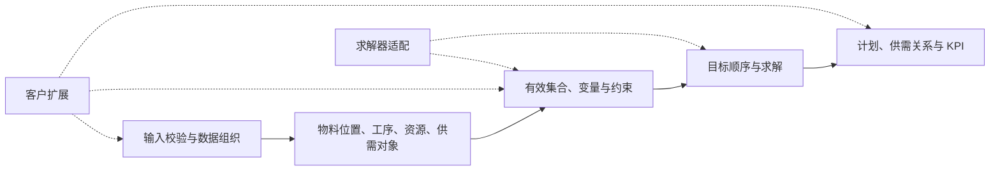

# Meta 部门负责人面试：中英问答与三个项目介绍

准备日期：2026-11-13。适用于本次约 45 分钟的英文面试。

本文依据现有项目材料及本轮复盘编写。下一轮题目属于准备建议，不是已知考题。岗位按首轮最新说明定位：在运营部门对接排产系统 IT 供应商，把控关键技术尤其算法细节，并协调外包制造方的供应链系统、排产系统与输入数据。

## 使用方式

先练自我介绍、岗位动机、松下主介绍、ATL 三方协作和 M6S 失败五题。三个项目各有约 30 秒概括、约 90–120 秒主介绍及独立追问。时长是练习目标，需按自己的录音校准；讲完主回答后停下来，根据问题选择追问内容。

英文为口述底稿，中文用于理解和复习。记住关键判断与事实，不必逐字背诵。过去经历用过去时，未来做法用 would。框架中的 S&OP 指支持该计划层次的算法能力，完整经营协调和审批流程超出已确认范围。

| 面试问题 | 首选材料 | 最应让对方记住什么 |
|---|---|---|
| 最成功的项目、业务价值 | P0/P1 松下 | 分层设计、业务交接、客户估算的清洗费用改善 |
| 复杂项目、规模扩展、架构取舍 | T0/T1 ATL | 本人新增主计划与校正层，设计候选逐步扩展机制 |
| 协调分歧、没有直接管理权如何推进 | A09 ATL 三方协作 | 共同业务里程碑、分阶段交付、输入版本管理 |
| 失败、需求遗漏、个人责任 | A10 M6S | 没有追究“同开同收”背后的运行机制 |
| 产品复用、团队效率、技术架构 | F0/F1 一体化框架 | 共用对象与建模流程、明确扩展位置、求解器适配 |
| 供应商评估、输入数据、上线判断 | A06–A08、A11、A16 | 用场景、数据和验收依据作出技术判断 |

## A. 部门负责人高优先级问答

### A01. Tell me about yourself. / 请介绍一下自己

目标：45–60 秒。

**英文主回答**

> I’m Jinfeng. My background is in operations research, with a focus on manufacturing planning and resource allocation.
>
> At HSBC, I work on workforce capacity planning and case assignment. Previously, at Youhualin, I led a small algorithm team and worked on planning systems for Panasonic and ATL. I also led the algorithm workflow design for a reusable supply chain planning framework.
>
> My relevant experience combines optimization design with working alongside planners and IT teams. Based on the first interview, I see a clear contribution in reviewing vendor solutions, clarifying planning requirements, and helping resolve data and implementation issues.

**中文理解：** 我有运筹优化、制造计划和资源配置背景；目前在汇丰做人力产能规划与任务分配，此前带领小型算法团队参与松下、ATL 及共用计划框架。与这个岗位相关的是优化设计，以及和计划员、IT 合作解决需求、数据与落地问题的经验。

**记忆：** 背景 → 当前工作 → 三项相关经历 → 岗位贡献。自我介绍不展开三个项目。

### A02. Why are you interested in this role? / 为什么选择这个岗位

目标：45–60 秒。此稿按本人“可以接受运营职责”组织，使用前确认其符合真实意愿。

**英文主回答**

> The first interview helped me understand the role more clearly. It sits within operations and involves reviewing the scheduling vendor’s technical approach and coordinating planning data and system integration with manufacturing partners.
>
> I’m comfortable with that scope. My optimization background would help me evaluate assumptions, identify missing constraints, and discuss trade-offs with the vendor. My experience working with planners and IT teams would help me move issues toward resolution.
>
> My longer-term interest is in manufacturing planning. I see a clear way to contribute through technical judgment and cross-team delivery in this role.

**中文理解：** 已理解岗位属于运营部门，主要做供应商技术方案把关及制造方数据、系统衔接；接受这项工作范围，并能用优化背景识别假设和约束遗漏，用协作经历推进解决问题。长期方向仍是制造计划。

**追问：Would you be comfortable if most software development were done by a vendor?**

> Yes. I would focus on making the requirements and acceptance criteria clear, reviewing important technical decisions, and checking whether the delivered plans support operations. I can discuss the implementation in depth when needed, while keeping the vendor accountable for the agreed deliverables.

中文：接受供应商负责主要开发，自己负责澄清要求、审查关键判断和检查交付效果；需要时深入技术，按职责推动供应商履约。

### A03. Why Meta? / 为什么是 Meta

目标：约 40 秒。以下是基于本岗位的动机；个人产品兴趣尚未补充，不声称已有产品使用经历。

**英文主回答**

> What attracts me to this opportunity at Meta is applying my planning experience in a hardware operations setting, working across manufacturing partners and a scheduling vendor. The first conversation made that connection much more concrete for me.
>
> I can contribute by translating operating requirements into technical questions, reviewing the proposed solution, and helping teams resolve implementation issues. That is closely connected to my experience with Panasonic and ATL and to the manufacturing planning work I want to continue developing.

**中文理解：** 以本次真实职责连接 Meta 的硬件运营场景，强调制造伙伴、排产供应商和运营要求之间的协作。若被进一步问及对公司或具体产品的兴趣，补充本人真实理由，避免凭空添加热情。

### A04. Why are you considering leaving HSBC? / 为什么考虑离开汇丰

**英文主回答**

> At HSBC, I have been applying optimization to workforce capacity and case assignment. It has given me experience with a different operational setting and with aligning definitions across teams.
>
> For my next step, I want to return to manufacturing planning, where I have several years of project experience. This role would let me apply that background to technical review and operational delivery while working closely with the teams that use the planning results.

**中文理解：** 肯定汇丰经历，说明长期希望继续制造计划方向，并将已有经验用于技术把关和运营落地。不评价现公司优劣，不虚构当前项目收益。

### A05. What would you bring to this team? / 你能给团队带来什么

**英文主回答**

> I would bring three things. First, enough optimization depth to examine how a vendor represents capacity, materials, and operating constraints. Second, delivery experience working with planners and IT teams on data and integration issues. Third, experience turning repeated planning problems into reusable model components.
>
> Panasonic demonstrates the first area, the ATL collaboration demonstrates the second, and the shared planning framework demonstrates the third. Together, they would help me connect technical decisions with operational requirements.

**中文理解：** 技术判断、跨团队交付、共用能力建设；分别用松下、ATL 三方协作、一体化框架证明。

### A06. How would you evaluate a scheduling vendor’s solution? / 如何评估供应商的排产方案

**英文主回答**

> I would start with the operating decision and the conditions that make a schedule usable. Then I would review the input definitions, critical constraints, objective priorities, and important simplifications in the model.
>
> I would agree on representative test cases with planners and the vendor, including scarce materials, shared equipment, capacity changes, and frozen work. Using the same input snapshot, I would compare feasibility, business outcomes, runtime, and the amount of manual adjustment against the current process.
>
> Before rollout, I would also check how failures are explained, how issues can be reproduced, and who approves exceptions. The acceptance criteria should be agreed before we judge the results.

**中文理解：** 先明确决策与可用条件，再检查输入、约束、目标和简化；与业务共同定义测试场景，用一致输入比较可行性、业务指标、耗时与人工调整；上线前明确异常处理、可复现性及批准人。这是拟采用的方法。

**追问：What if the vendor cannot share its source code?**

> I would ask for enough information about assumptions, constraints, supported scenarios, and solver outcomes to evaluate the solution. Controlled test cases and reproducible outputs can reveal many issues. If an important risk still cannot be evaluated, I would make that gap explicit before recommending acceptance.

中文：通过假设说明、场景范围、求解状态和可复现测试评价；关键风险无法判断时，明确验收证据缺口。

### A07. The vendor says the algorithm is optimal, but planners cannot use the output. What would you do? / 算法声称最优，但计划员认为不可用

**英文主回答**

> I would ask for one specific example of an unusable schedule and reproduce it using the original input snapshot. I would check the data, the operating constraints, the objective priorities, and any changes made during post-processing.
>
> A solution can be optimal for its model while the model misses an important operating rule. My M6S experience is an example: encouraging synchronized production did not fully represent shared-equipment use.
>
> Once we identify the cause, I would agree on the correction and the acceptance case with the vendor and planners. I would check the final schedule, including post-processing, before calling the issue resolved.

**中文理解：** 固定具体问题与输入，沿数据—模型—目标—后处理定位；模型最优只针对其表达的问题，仍可能遗漏现场规则；修改后检查最终业务输出。

### A08. How would you handle unreliable input data from a manufacturing partner? / 制造方输入数据不可靠怎么办

**英文主回答**

> I would first identify which decisions depend on the questionable data and how serious the impact could be. For critical fields, I would agree on the source, owner, definition, unit, timestamp, and update frequency with the manufacturing partner.
>
> I would add checks for missing values, inconsistent references, and important reconciliations, such as whether inventory and work in progress refer to the same planning snapshot. I would also distinguish confirmed values from estimates.
>
> If a critical gap prevents a reliable decision, I would recommend resolving it or limiting the rollout scope. Any temporary assumption would need an owner, an expiry point, and a clear explanation of its impact.

**中文理解：** 先判断影响，再统一来源、责任人、含义、单位和时点，检查缺失与跨表关系；关键缺口需补齐或缩范围，临时假设应明确责任和有效期。

**追问：Can you give a concrete example?**

> For example, a production rate may mean nominal machine speed or sustained output under normal conditions. Yield may already be included, or it may need to be applied separately. I would clarify that definition before using the rate to calculate capacity, so we neither overstate output nor count the same loss twice.

中文：生产速率可能是额定值或实际稳定值，良率是否已经包含必须澄清，防止高估产能或重复扣减。此为讲解示例，不声称在 Meta 或过往现场已发生。

### A09. Tell me about a time you aligned stakeholders with different priorities. / 如何协调不同目标的团队

目标：约 90 秒。案例：ATL 算法／IT／PC 三方协作。

**英文主回答**

> At ATL, our algorithm team needed more reliable test data while keeping development effort under control. IT wanted direct database integration, and production planners wanted usable schedules as soon as possible.
>
> I invited the IT lead to observe how we diagnosed infeasibility and schedule defects. I also asked the planning lead to explain what still prevented schedules from being released to production. That helped us agree on the operational milestone.
>
> We agreed to keep versioned file inputs during debugging. IT would build the input interface and version management. Our team would work on algorithm quality and runtime, and start database adaptation after a limited rollout in Dongguan.
>
> Input version management was implemented, with ATL maintaining the inputs. My contribution was making the dependencies visible and agreeing on a sequence in which each team had a clear responsibility.

**中文理解：** 我方要测试数据和控制开发投入，IT 要集成，PC 要可用计划；让 IT 看真实排障、让 PC 说明下发障碍；围绕业务里程碑安排文本输入、版本管理和后续集成。已确认结果是版本管理落地。

**追问：What did you compromise on?**

> We accepted responsibility for improving the algorithm within an agreed timeframe and committed to starting database adaptation after the limited rollout. IT supported versioned file inputs during debugging. The agreement addressed both the immediate need for usable schedules and the later integration work.

中文：我方承担有期限的算法改进与后续适配，IT 承担调试阶段输入支持。双方调整的是交付顺序与责任。

**追问：Why files? Could a database also provide reproducibility?**

> Yes. Database snapshots or versioning can also preserve reproducible inputs. Files were convenient at that stage because we could inspect them with planners in Excel and reproduce problems quickly. The underlying requirement was reproducibility and joint diagnosis.

中文：数据库快照也能满足可复现需求，文件是当时方便联合排障的选择。

**事实备注：** 当时还约定两个月内将“生成计划”耗时控制在 20 分钟内，且 PC 小幅调整后可下发。是否按期达成、数据库适配是否完成尚未补充，不将其说成已完成结果。

### A10. Tell me about a failure. / 介绍一次失败

目标：约 90 秒。采用本轮最新补充：上线阶段由客户 PC 发现；本人没有追究同开同收背后的运行机制。

**英文主回答**

> One failure was in ATL’s M6S scheduling project. During rollout, the customer’s production planners identified a problem with how our schedules handled shared equipment.
>
> My mistake was in understanding the requirement. The planners had asked for machines to start and finish together as much as possible. I implemented that request without investigating the operational reason behind it.
>
> Winding machines shared supporting equipment that could not switch during a continuous batch. Encouraging synchronized starts and finishes did not fully capture that restriction.
>
> I revised the candidate batches to include compatible combinations of winding and supporting machines. The production planning team then reviewed the revised schedules.
>
> I learned to investigate the operating mechanism behind a user’s request. In a similar project, I would walk through a complete batch with planners and validate shared-resource use before rollout.

**中文理解：** PC 在上线阶段发现共享设备问题；我直接开发了同开同收要求，没有理解原因；改为候选批次表达资源组合，由 PC 审核；今后提前走查完整批次并验证资源占用。

**追问：Why did you miss it?**

> I treated the requested behavior as a sufficiently defined requirement. I moved into implementation before checking which physical restriction that behavior was intended to address. I should have investigated that connection earlier.

中文：把操作要求误认为已经充分明确的需求，未先调查背后的物理限制。

**追问：Why would a stronger synchronization objective not be enough?**

> A stronger objective can make synchronized schedules more attractive, but it does not necessarily rule out invalid shared-equipment use. The model needed to represent the compatible resource combinations and their use during the continuous batch.

中文：加大偏好权重无法自动排除非法共享，关键在于正确表达资源组合和连续占用。

**追问：How would this change the way you review a vendor?**

> I would trace important requirements back to the operating mechanism and agree on a concrete test case with the manufacturing partner. For shared equipment, I would ask the vendor to show how a complete batch occupies those resources and how conflicting use is prevented.

中文：将关键要求追溯到现场机制，用完整批次场景审查供应商如何表达占用和冲突。

**尚待本人补充：** 当时实际损失、是否阻碍下发或造成延期、修正耗时、PC 的具体验收步骤。当前回答不添加这些事实。PC 后续审核及人工调整从约 3 小时降到 20 分钟是已确认结果，但不能全部归因于本次修正，也不能代替实际生产验证。

### A11. What if the rollout date is fixed but a critical issue remains? / 上线日期已定但关键问题未解决怎么办

**英文主回答**

> I would explain the issue in terms of the affected decisions and operational impact. Then I would identify which scope is blocked and whether a smaller useful scope can be supported with agreed checks and a fallback process.
>
> I would present the options with a recommendation: fix the issue before release, reduce scope, or move the date. Each option would include an owner, dependencies, and the remaining risk. The person accountable for the operational commitment should make the final decision with that information.

**中文理解：** 说明业务影响，识别阻塞范围；提出修复、缩范围或延期选项，带上建议、责任和风险交由有权限的人决定。不能隐去关键缺口来维持表面进度。

### A12. What would you do in your first 90 days? / 入职前 90 天会做什么

**英文主回答**

> In the first month, I would learn the planning workflow, the manufacturing partners’ data, the vendor’s solution, and the team’s decision responsibilities. I would agree with my manager on one priority problem and a baseline.
>
> In the second month, I would work with the relevant teams to reproduce that problem, agree on requirements and acceptance cases, and establish clear owners for the dependencies.
>
> In the third month, I would aim to validate an improvement or a limited pilot, depending on readiness. I would report the measured result, remaining issues, and a recommendation for the next step.

**中文理解：** 先了解流程与责任、确定优先问题；再复现和约定验收；条件允许时验证改进或试点。不是预先承诺三个月全面上线。

### A13. How would you keep me informed? / 你会如何向负责人汇报

**英文主回答**

> I would lead with the operational impact and my recommendation. Then I would explain what is confirmed, what remains uncertain, the owner and date for the next action, and any decision I need from you.
>
> For example: the pilot is blocked by inconsistent inventory timestamps; we have reproduced the issue; the manufacturing partner owns the correction; and I recommend keeping the current process for the affected scope until we verify the new data.

**中文理解：** 先影响与建议，再事实、不确定性、责任人、下一步时间及需要的决策。例子为模拟情景，不是本人既有事故。

### A14. What are you working to improve? / 你正在改进什么

**英文主回答**

> One area is making complex technical explanations more concise. I can spend too much time establishing context before giving the main decision and result.
>
> I received that feedback in the first interview. I’m addressing it by preparing a short summary first, making my own contribution explicit, and saving the detailed mechanism for follow-up questions. That is also important for this role, because different stakeholders need different levels of detail.

**中文理解：** 坦诚说明技术表达过长，并用本轮实际练习体现反馈吸收。此回答仅在被问到改进点或反馈时使用，无需开场主动解释紧张。

### A15. What experience would you still need to build? / 哪些经验需要补充

**英文主回答**

> My strongest experience is in planning algorithms and working with planners and IT teams. I would still need to learn this team’s manufacturing processes, partner systems, and operating routines.
>
> I would do that by reviewing real planning cases with the relevant operations and engineering teams, clarifying how key inputs are measured, and following issues through to resolution. At the same time, I could contribute immediately through model review, data definitions, and structured problem diagnosis.

**中文理解：** 承认需要学习团队特定工艺、系统与运营节奏；提出学习方式，同时说明可以立即贡献什么。不将驻场经历扩大成直接负责工艺、良率或设备工程。

### A16. How would you hold a vendor accountable without creating an adversarial relationship? / 如何推动供应商履责并保持合作

**英文主回答**

> I would agree on the expected outcome, acceptance evidence, responsibilities, and milestones early. When an issue appears, I would bring a reproducible case and explain its operational impact, then ask the vendor for a diagnosis and a recovery plan.
>
> I would track actions against the agreed evidence and dates. I would also check whether our own data or decisions are blocking progress. If the disagreement cannot be resolved at the working level, I would escalate it with the facts, options, and my recommendation.

**中文理解：** 用交付标准、证据、责任和时间推动履约，同时检查己方依赖；无法解决时带事实与建议升级。此为拟采用方法，不声称已有采购合同或商务谈判职责。

## P. 松下项目：成功案例与技术判断

### P0. Panasonic — 30-second summary / 30 秒概括

**英文主回答**

> I led the algorithm solution for Panasonic Electronic Materials’ planning system. I designed a layered approach to coordinate materials, equipment, molds, and delivery commitments. After deployment, changeovers fell by about ten per month, representing roughly RMB 300,000 in estimated monthly cleaning-cost savings based on the customer’s calculation.

**中文理解：** 本人负责算法方案，设计分层协调物料、设备、模具和交期；每月少约 10 次换型，客户估算清洗费用节约约 30 万元。

### P1. Tell me about your most successful project. / 90–120 秒主介绍

**英文主回答**

> One of my most successful projects was a production planning system for Panasonic Electronic Materials, where I led the algorithm solution. After deployment, changeovers decreased by about ten per month, representing approximately RMB 300,000 in estimated monthly cleaning-cost savings based on the customer’s calculation.
>
> The challenge was to reduce changeovers while coordinating materials, equipment, molds, and delivery commitments. I made two key design decisions.
>
> First, I used a layered approach. MRP selected relevant production routes and material alternatives before detailed resource planning. That reduced the combinations carried into the daily model.
>
> Second, I made the business handoffs explicit. Orders with material shortages needed procurement confirmation before delivery dates were quoted. Planners kept ownership of their relatively stable material calendar and selected the finished-goods quantities to send into detailed scheduling.
>
> I agreed on the design with the customer’s IT and planning teams. My contribution was connecting the optimization structure with the decisions and workflow that the customer needed.

**中文理解：** 结果先行；两个关键判断是“先收敛路径再细化资源”与“明确采购、PC 和详细排程的交接”；说明本人方案责任及客户共同确认。

### P2. How did the planning layers work? / 各层分别决定什么

**英文主回答**

> MRP selected relevant routes and identified material shortages. The daily model then decided production quantities and resource use, including mold planning. Planners selected confirmed finished-goods quantities, which the back-end system converted into APS demands. APS and its post-processing developed the detailed mold assignments and furnace-batch arrangements.

**中文理解：** MRP 选路径与诊断缺料 → 日度模型安排数量和资源 → PC 确认成品量、后台转换 → APS 与后处理形成模具及炉批安排。

| 层次 | 输入或条件 | 主要输出 |
|---|---|---|
| MRP | 需求、库存、供应、BOM、路径及替代料 | 选用路径、缺料及受影响需求 |
| 日度计划 | 路径范围、材质日历、模具与其他资源条件 | 分期产量、供需安排、模具日历 |
| 业务交接 | PC 选定的主计划成品量 | 后台转换的 APS 需求 |
| APS 与后处理 | 确认需求、物料与设备条件 | 细化数量、模具安排及炉批明细 |

### P3. Why did you use a layered approach? / 为什么分层，有什么代价

**英文主回答**

> Products had many route and material alternatives. Carrying all of them into detailed time and resource decisions would create too many combinations. Selecting relevant routes first kept the detailed model manageable.
>
> Different decisions also had different levels of certainty. The material calendar was relatively stable, while near-term mold arrangements needed more detail. The trade-off was that some choices were made at a coarser level, so the handoffs and downstream results needed attention.

**中文理解：** 控制组合规模，并匹配信息确定性；代价是较粗层次提前确定部分选择，必须关注交接与下层结果。不声称分层获得整体全局最优。

### P4. How did mold-change iteration work? / 换模迭代怎样工作

**英文主回答**

> The daily model identified mold-related capacity gaps. The procedure then evaluated local changes to the mold calendar, considering available mold sets, material timing, and existing orders that would be displaced.
>
> After changing one calendar window, we re-solved the production plan to coordinate the wider impact. The local search reduced the search effort, but it did not guarantee a globally optimal mold schedule.

**中文理解：** 模型定位模具缺口 → 局部评估日历变更，兼顾套数、供料与原工单 → 修改窗口 → 重求解。除非继续追问，不展开枚举、评分或停止参数。每项细分评分规则的原始作者未逐项确认，不全部称为个人独创。

### P5. How did you balance delivery commitments and changeovers? / 怎样权衡交期与换型

**英文主回答**

> Delivery priorities were reflected in the staged objectives. Existing commitments received priority, capacity violations were assessed, and new demand was considered in that sequence. Mold-calendar changes considered both demand benefit and disruption to existing work. In APS, reducing mold-use intervals followed the delivery objectives.
>
> The important point was to make the priorities and remaining capacity gaps visible, rather than assume that every computed plan was automatically executable.

**中文理解：** 分阶段目标表达承诺、能力和新增需求的顺序；换模评估考虑原计划影响；仍需检查能力缺口，不能仅凭有解就认为可执行。

### P6. How did you measure the result? / 如何衡量结果

**英文主回答**

> Changeovers decreased by around ten per month. Panasonic estimated cleaning cost at RMB 30,000 per change, giving estimated monthly savings of about RMB 300,000. Over three months, planning results also showed 99.9 percent fulfillment against confirmed dates. That figure described planned fulfillment, not actual shipment performance.

**中文理解：** 清洗费用由客户估算；99.9% 为三个月计划指标。缺料需求是否计入该指标分母尚未确认，不临场补造统计口径。

### P7. What did you personally own? / 本人的贡献边界

**英文主回答**

> I designed the layered planning strategy and led the algorithm solution. We agreed on the design with the customer’s IT and planning teams. Planners owned the material calendar and selected the confirmed quantities for detailed scheduling. The back-end system handled the conversion into APS demands.

**中文理解：** 本人负责分层与算法；共同确认方案；PC 与后台各有明确责任。与新岗位的关联是能够审查方案假设和层间交接，而不只检查模型公式。

## T. ATL 项目：规模扩展与分阶段决策

### T0. ATL — 30-second summary / 30 秒概括

**英文主回答**

> At ATL, I extended an existing daily-scheduling solution for a much larger factory. I added master planning and a post-scheduling correction layer, and designed an iterative approach that progressively expanded candidate batches. Later, planners’ review and manual adjustment time fell from about three hours to twenty minutes.

**中文理解：** 从原有日计划扩展到更大规模，新增主计划与校正层，设计候选逐步扩展；后续审核及人工调整时间从约三小时降至二十分钟。

### T1. Tell me about a complex project you led. / 90–120 秒主介绍

**英文主回答**

> At ATL, the main challenge was extending production scheduling from Dongguan to the much larger Ningde factory. The existing solution had daily scheduling, and I led important changes to its algorithm structure.
>
> I added a master-planning layer to allocate demand and capacity before detailed scheduling. Daily scheduling could then focus on continuous batches and machine combinations. I also added a correction layer to handle finer changeover and capacity effects while preserving the main schedule structure.
>
> To control model size, I designed an iterative approach that started with a sparse set of candidate batches and progressively added options based on the solve results.
>
> We kept some capacity margin in master planning so detailed schedules had room to work. That reduced the risk of overly tight allocations, but could increase changeovers.
>
> Later, planner review and manual adjustment time fell from about three hours to twenty minutes. My main lesson was to make the decision boundaries explicit and assess the final plan across the whole process.

**中文理解：** 宁德规模触发架构变化；本人新增主计划和校正层、设计稀疏候选迭代；产能余量降低分配过紧风险，但可能增加换型；最后说明具体工作环节的改善。

### T2. How did the three layers work? / 三层分别做什么

**英文主回答**

> Master planning allocated demand and capacity across planning scopes. Daily scheduling selected continuous batches and machine arrangements within those scopes. The correction model then refined changeover and capacity effects using the earlier schedule as a baseline.
>
> Master planning fed directly into distributed daily-scheduling runs. Planner review happened later in the workflow, rather than between master planning and daily scheduling.

**中文理解：** 主计划分配需求与能力 → 日计划安排连续批次和机台 → 校正层基于前层结果细化。主计划后直接运行分布式日计划，PC 审核在后面。

| 层次 | 主要决策 | 交接与代价 |
|---|---|---|
| 主计划 | 按业务范围分配需求与聚合能力 | 给下层需求份额和部分资源候选；粗化损失部分细节 |
| 日计划 | 连续生产批次、具体机台与配套安排 | 候选规模与计算效率之间存在取舍 |
| 排程后校正 | 更细换型、跨日能力和必要数量调整 | 保留主要结构但允许修正，需要检查偏差 |

### T3. Why not just increase the size of the original model? / 为什么不能直接放大原模型

**英文主回答**

> The combinations of products, machines, dates, and continuous batches grew too large. Separate local schedules also needed a common basis for deciding which demand each scope would handle. Master planning provided that allocation before the detailed scheduling problems were solved.

**中文理解：** 控制批次、机台和日期的组合增长，同时提供跨范围的统一需求分配。不要混用松下的“MRP 先选替代料路径”来解释 ATL。

### T4. How did you manage the risk of bad master-plan allocations? / 上层分配如何给下层留出空间

**英文主回答**

> We kept a capacity margin in master planning to allow for details that appeared in daily scheduling. During six months after rollout, we did not observe daily-plan shortages caused by incorrect master-plan allocation. The trade-off was additional changeovers.
>
> I would still describe that as an observed result within that period, rather than a guarantee for every demand pattern. The capacity margin and the downstream effects need to be assessed together.

**中文理解：** 产能折扣留余量；半年内未观察到由主计划错误分配导致的日计划欠交；代价是额外转型。不扩大成所有需求零欠交或实际出货 100%。折扣比例及校准方式尚未补充。

### T5. How did progressive candidate expansion work? / 候选逐步扩展怎样控制复杂度

**英文主回答**

> I started with a limited set of candidate production batches, solved the model, and used the results to decide where additional candidates were needed. We then expanded the choices and solved again.
>
> This kept the initial problem smaller while allowing more alternatives later. The trade-off was that a restricted candidate set could miss better schedules. I would assess solution quality alongside runtime and the candidate-expansion rules.

**中文理解：** 稀疏候选起步，按解增补并重求解；候选限制可能漏掉更优方案。可称 iterative solving with progressive candidate expansion；不称为已证明使用对偶定价的严格列生成。

### T6. Why was a correction model necessary? / 为什么还需要校正层

**英文主回答**

> Daily scheduling focused on batch selection and machine arrangements. Some detailed changeover effects were simplified there. The correction model used the existing schedule as a baseline and refined capacity and changeover effects, allowing necessary adjustments while retaining its main structure.
>
> That reduced the burden on the earlier model, but it also meant we needed to inspect the corrected quantities and deviations before judging the result.

**中文理解：** 日计划已经考虑部分换型；校正层细化更复杂的影响，不是原日计划完全忽略换型，也不只是甘特图展示。

### T7. What was your contribution, and how was it validated? / 你的贡献和验证边界

**英文主回答**

> I added master planning and the correction layer, designed the candidate-expansion approach, and worked on the M6S resource-combination improvement. I also helped align the algorithm, IT, and planning teams on reproducible inputs and delivery sequencing.
>
> The planning team reviewed the revised plans. The confirmed workflow result was that review and manual adjustment time fell from about three hours to twenty minutes. I would not attribute that entire improvement to one algorithm change.

**中文理解：** 四项算法工作和三方协作；验证证据是 PC 审核与特定环节工时改善。整个 ATL 不是全部失败项目，失败题应明确聚焦 M6S 的上线挫折。

## F. 供应链产品一体化算法架构：共用基础与可扩展交付

### F0. Integrated planning framework — 30-second summary / 30 秒概括

**英文主回答**

> I led the algorithm workflow design for a reusable framework supporting MPS, MRP, and S&OP planning models. It gave engineers shared domain objects, model components, solver integration, and result processing. I personally designed and implemented the solver adaptation layer. The goal was to improve development efficiency and make customer-specific solutions easier to build and maintain.

**中文理解：** 直接用户是算法工程师，共用数据、对象、模型、求解和结果处理；本人主导算法流程并独立完成求解器适配；目标是提升开发效率与可维护性。

### F1. Tell me about the integrated algorithm architecture. / 90–120 秒主介绍

**英文主回答**

> I led the algorithm workflow design for a shared supply chain planning framework. Its main users were algorithm engineers, especially those who needed to build a correct planning model without recreating the infrastructure for every project.
>
> The foundation was a discrete-time production planning model. MPS, MRP, and S&OP planning share material flows, inventory, demand, and production decisions across time. We reused that structure and expressed differences through capacity rules, constraints, objectives, and time granularity.
>
> The workflow covered data checks, shared domain objects, model construction, sequential objectives, solver integration, and result processing. Customer-specific rules could extend the input, model, or output layers.
>
> I personally designed and implemented the Gurobi and CPLEX adaptation layer, with an optional Pyomo path. The domain model was a shared effort, largely drawing on my earlier AUX work, and the product manager designed the product interfaces.
>
> The framework reduced repeated development and gave the team a common language for implementation, handovers, and reviews.

**中文理解：** 面向算法工程师；共用离散时间生产计划结构；输入校验—对象—建模—顺序求解—结果处理；客户扩展位置清楚；本人、团队及 PM 分工准确；收益包括开发复用与团队一致认知。

### F2. How would you explain the architecture to a department head? / 如何向负责人解释架构

**英文主回答**

> I would explain it in three parts. First, the data layer gives materials, locations, resources, demand, and supply a consistent meaning. Second, the model layer converts those objects into decisions and constraints for the chosen planning scope. Third, the result layer converts the solution back into plans and supply-demand relationships that can be checked and explained.
>
> The solver adapter sits underneath the model layer. Customer extensions can change specific business rules while reusing the common workflow.

**中文理解：** 业务语义、决策模型、业务结果三部分；求解器位于模型之下，客户差异通过扩展表达。

| 架构部分 | 要回答的业务问题 | 共用能力 |
|---|---|---|
| 输入及领域对象 | 什么物料在什么位置、何时可用，能通过哪些流程转化 | 物料库存点、工序、资源、采购与运输、供需对象 |
| 模型组件 | 各时段生产、采购、运输、库存和交付多少 | 有效索引集合、变量、流量平衡及能力约束 |
| 目标与求解 | 先保护什么，允许怎样的取舍，运行多久 | 目标顺序、保护前序结果、后端适配、解提取 |
| 结果处理 | 数学量对应什么计划，哪笔供应满足哪笔需求 | 计划对象、满足关系、虚拟结构还原、KPI |
| 客户扩展 | 哪些业务规则与共用模型不同 | 输入转换、约束扩展、输出扩展 |

### F3. What does “integrated” mean here? / 一体化具体指什么

**英文主回答**

> It means the planning modules share domain objects, modeling components, the solution workflow, and result structures. They can reuse the same foundation while applying different capacity policies and business rules.
>
> In the implementation, MRP, MPS, and SOP had their own entry points and extensions. The framework did not by itself establish an automatic end-to-end S&OP management and approval process.

**中文理解：** 一体化是算法底座和对象、流程、结果结构的共用。三个模块仍有各自入口，不能说成全部业务流程自动串成闭环。

### F4. What was shared, and what differed between MRP, MPS, and SOP? / 三类计划怎样复用

**英文主回答**

> They shared time-based material balances and decisions about production, supply, inventory, and demand fulfillment. In our framework, MRP treated standard production capacity as unconstrained for material analysis. MPS added finite production capacity. SOP extended the model to represent normal and overtime capacity.
>
> Time granularity, constraints, objectives, and outputs could then vary with the use case. Detailed machine sequencing still required additional modeling when the business needed it.

**中文理解：** 共用物料流和数量决策；本框架 MRP 的标准生产能力放开，MPS 加有限能力，SOP 扩展正常与加班能力。MRP 并非取消采购、运输等所有限制；这些是本框架设计，不是所有产品的统一定义。

### F5. Why use a product-stock-point object? / 为什么用物料库存点对象

**英文主回答**

> A material’s identity alone does not tell us whether it can satisfy a demand. Its location and availability time also matter. A product-stock-point object let us balance inventory, supply, and consumption for one material at one location. Production and transport connected those nodes, with their timing and quantity relationships.

**中文理解：** 物料身份不足以判断可用性，位置和时间同样关键。PSP 以物料×位置为守恒节点，再由生产和运输连接。

简化解释：期末库存 = 期初库存 + 到达供应及产出 − 生产消耗、调出与交付。时间映射、良率和投入产出系数另行表达；这不是脱离日期的总量相减。

### F6. How did virtual objects help reuse? / 虚拟物料和路径如何支持复用

**英文主回答**

> Some substitution choices could be represented as a small network. For example, one unit of A or two units of B could each produce one virtual intermediate. The real production step would consume that intermediate, allowing the common balance model to choose the eligible input.
>
> We kept mappings to the original business objects and removed the virtual structure from the business output. The important checks were quantity conservation, eligibility, timing, and correct restoration of the result.

**中文理解：** 用 A→V 或 2B→V 表达替代关系，复用流平衡；输出时恢复真实业务含义。A、B、V 是讲解示例。虚拟节点不创造真实库存。

**追问：When would this abstraction be insufficient?**

> When the rule depends on an indivisible batch, a particular sequence, or synchronized use of several machines, a flow-network transformation may not capture it fully. I would add a targeted constraint or scheduling extension and validate the operating scenario.

中文：不可拆批次、排序和多机同步占用可能需要专用扩展；M6S 可作为具体例子。

### F7. What did you build in the solver adaptation layer? / 求解器适配层做了什么

**英文主回答**

> I designed and implemented a common interface for variables, constraints, objectives, solving, and solution access, with Gurobi and CPLEX backends and an optional Pyomo path. I also handled selected differences in parameters and solver statuses.
>
> That allowed the business model and result processing to be reused. Advanced backend capabilities were not identical, so I would make supported features and termination behavior explicit when evaluating a deployment.

**中文理解：** 本人独立设计开发共用建模和取解接口，处理部分参数与状态差异。支持多后端不等于所有高级能力、容差和返回解完全相同。

### F8. How did you handle multiple objectives? / 多目标如何处理

**英文主回答**

> The framework solved configured objectives in sequence and added constraints to protect earlier results before moving to the next objective. That made the priority order explicit.
>
> The protection included tolerances and could apply to grouped quantities. It was important to understand what was protected and how much freedom remained for later objectives. I would not claim an exact global lexicographic optimum for every run.

**中文理解：** 按目标顺序求解，加约束保护前序结果；存在容差及分组保护，不保证所有运行严格全局字典序最优。

### F9. How did you keep reuse from making customer solutions rigid? / 如何兼顾复用与客户差异

**英文主回答**

> We standardized the common workflow and model components, and kept extension points in input processing, constraints, and outputs. Panasonic, for example, added mold and material-calendar rules around the shared foundation.
>
> I would bring a capability into the common core when it addresses a recurring need with clear semantics. A rare or highly specific rule could remain an extension. Core changes also need checks against existing customer behavior.

**中文理解：** 共用基础稳定，输入、模型、输出可以扩展；重复需求适合沉淀，少见规则保留扩展。后两句是建议原则，不虚构当时已有正式产品治理制度。

### F10. What was the value, and what would you improve? / 价值与下一步改进

**英文主回答**

> It reduced repeated development and gave engineers a shared model structure and terminology. That helped with project handovers, bringing in new developers, and code reviews. I do not have a single measured percentage for the overall efficiency improvement.
>
> For further development, I would strengthen checks for usable solutions and termination reasons, and expand representative tests across planning modules and solver backends. I would measure time to a correct first model, delivery effort, and the quality of the final plans.

**中文理解：** 价值是减少重复开发和提升协作效率，没有统一收益比例。改进方向是可用解判断、终止原因和跨模块／后端验证；不能声称现有测试覆盖全部场景。

## B. 向负责人反问

现场选两三题，根据已讨论内容调整。

1. **What is the most important problem you would want this person to solve in the first six months?** 前六个月最需要解决什么具体问题？
2. **What would this role own in technical acceptance of the vendor’s solution, and which decisions would need your approval?** 在技术验收上负责什么，哪些决定需要您批准？
3. **Where are the biggest gaps today: planning logic, input data, system integration, or day-to-day use?** 当前缺口主要在算法、输入、集成还是日常使用？
4. **How do operations, manufacturing partners, and the vendor resolve disagreements about whether a schedule is usable?** 对计划可用性有分歧时，各方怎样作出判断？
5. **How would you measure success for this role beyond completing system delivery?** 除完成系统交付外，如何衡量这个岗位的成功？

## C. 关键事实与未确认信息

| 内容 | 可讲的口径 |
|---|---|
| 当前岗位定位 | 首轮确认运营部门、供应商技术尤其算法把关、制造方系统与输入对接；具体决策权待负责人说明 |
| 松下费用改善 | 每月少约 10 次换型，客户按每次约 3 万元清洗费用估算，约 30 万元/月 |
| 松下 99.9% | 三个月的确认交期计划满足指标；不是实际出货率，缺料订单是否计入分母未确认 |
| ATL 3 小时→20 分钟 | PC 审核及人工调整时间，不能说成算法运行时间或全部工作量 |
| ATL 90% | 拟减员目标，实际实施未确认；已提交简历如被问到该数字，需要澄清 |
| ATL 两个月交付目标 | 当时约定两个月内计划生成不超过 20 分钟，是否按期达成未确认 |
| ATL 主计划衔接 | 主计划后直接分布式运行日计划，PC 不在两者之间审批 |
| ATL 半年观察 | 未见因主计划错误分配造成的日计划欠交；有额外转型代价 |
| M6S 最新补充 | 上线阶段由客户 PC 发现；本人直接接受同开同收要求，没有追究背后机制 |
| M6S 待补事实 | 实际业务损失或延期、修正耗时、具体 PC 验收步骤；不编造停线或全量生产验证 |
| 一体化框架分工 | 本人主导算法工作流并指导工程师；独立设计开发求解器适配；领域模型共同完成并参考本人奥克斯设计；PM 设计产品接口 |
| 一体化框架价值 | 减少重复开发、统一术语与模型理解；无统一量化收益比例 |
| 未来方法 | 验收矩阵、数据责任、上线回退、90 天计划等为建议，用 would 表达 |

如果被问到简历中的 ATL 90%，可直接说明：

> I should clarify that figure. The 90 percent referred to a proposed staffing reduction, which I cannot confirm was implemented. The confirmed workflow result was that planner review and manual adjustment time fell from about three hours to twenty minutes.

## D. 三天口述安排

| 时间 | 练习内容 | 验收方式 |
|---|---|---|
| 第一天 | A01、A02、P1、A09、A10；再练 T0、F0 | 每题录音，前 15 秒答题；主案例两分钟内结束；个人贡献与事实正确 |
| 第二天 | 45 分钟英文模拟；加入 A06–A08 和三个项目追问 | 模拟被打断；能先回答新问题；回听并重录最弱两题 |
| 第三天 | T1、F1、失败追问、岗位动机、反问；短模拟 | 不看完整稿；只看关键词；不新增大量技术细节 |

建议模拟分配：开场与动机 5 分钟，松下及追问 8 分钟，ATL／失败及追问 10 分钟，供应商与数据情景 10 分钟，框架或补充经历 5 分钟，反问 7 分钟。这是练习安排，真实节奏由面试官决定。

需要组织思路时：**Let me give you the main point first.**

需要明确个人责任时：**My specific responsibility was…**

需要说明取舍时：**The trade-off was…**

被追问具体问题时，先直接回答，再补一个理由与例子。回答已经完整时停下来。

## E. 资料依据

本稿整理现有材料及本轮本人补充，没有重新运行项目源码或客户算例。

- [既有中英准备材料](C:/Users/HP/Desktop/application_material/meta/Meta_供应链优化产品经理_中英面试准备.md)
- [松下项目决策与输入输出](C:/Users/HP/Desktop/application_material/meta/松下项目_决策过程与输入输出详解.md)
- [ATL 项目决策与输入输出](C:/Users/HP/Desktop/application_material/meta/ATL项目_决策过程与输入输出详解.md)
- [一体化框架产品设计与技术详解](C:/Users/HP/Desktop/application_material/meta/MPS_SOP_MRP一体化框架_产品设计与技术详解.md)
- 本轮首轮面试复盘：岗位范围、约十分钟的松下主陈述、表达反馈，以及 M6S 需求理解责任与发现阶段。
